# Depot

**A downloads section for Flarum 2.** Files with versions and changelogs, a published checksum for every release, ratings and reviews, a support discussion for each file, and category permissions, all built from Flarum's own components so it looks like the rest of your forum.

> **Status: design prototype.** The pages below run inside a real Flarum 2.0.1 forum, but on sample data (`js/src/forum/data.js`). There are no tables or API yet. The backend is built once the design is signed off.

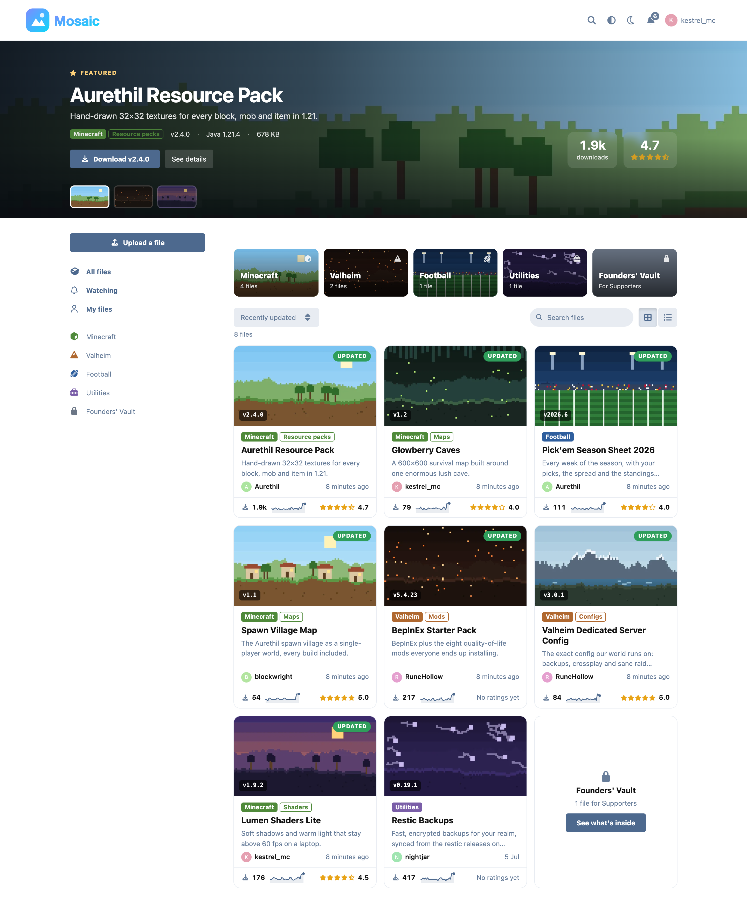

## What it does

**Browse**
- A featured spotlight across the top: the forum's best files, one at a time, with a download button right there.
- Category tiles, then every file as cards or a list (the choice is remembered).
- Sort by recently updated, most downloaded, top rated or newest. Inside a category, filter by the version a file works with.
- Each file shows its version, who made it, how recently it changed, its downloads with a 30-day trend line, and its rating.
- Files for a paid group appear as a locked teaser instead of disappearing, with a link to get access.

**A file's page**
- Screenshots with a full-size viewer (arrow keys move between them).
- At a glance: what it works with, custom fields, licence, what else you need, and numbered install steps.
- What's new in this version, grouped into Added, Changed and Fixed.
- Every version on a timeline, each with its own changelog, size, download count, checksum and download button. Older versions are also one click away from the download button's menu.
- Reviews with a rating breakdown you can filter by, the author's reply under a review, and "helpful" votes.
- The support discussion, a normal forum discussion, so replies, mentions and notifications all work.

**Downloading**
- After the click, a sheet shows how to check the file is the real one: the right command for macOS, Windows or Linux (detected automatically) and the checksum it should print, both with copy buttons. Then the install steps, and a button to watch for the next version.

**Uploading**, in five short steps:
1. **File:** upload it, link to where it's hosted, or point at a GitHub repository so every release appears automatically. An uploaded file's SHA-256 is worked out in the browser as soon as it's dropped.
2. **Details:** name, category, version, what it works with, a one-line summary.
3. **Screenshots:** drag in up to eight. The first is the cover.
4. **Support:** start a support discussion for the file and pick which of the forum's tags it goes in, with a preview of how it will look in the discussion list.
5. **Review:** check it over and send it for approval.

**For admins**
- Permissions in Flarum's own Permissions page: view, download, upload, upload without approval, rate and review, moderate.
- Settings for how often a repeat download counts, the largest upload, support discussions, and GitHub sync.

**For developers**
- An update-check endpoint per file (latest version, checksum, size, URL), so mods and launchers can ask whether there's a new version without loading the page.

## Screenshots

| | |
|---|---|
| 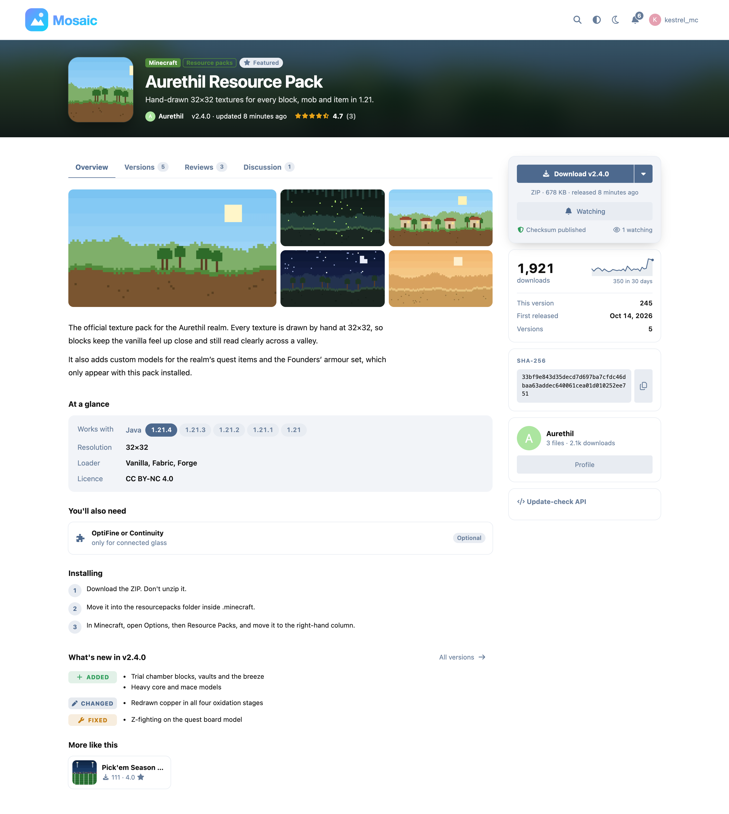 | 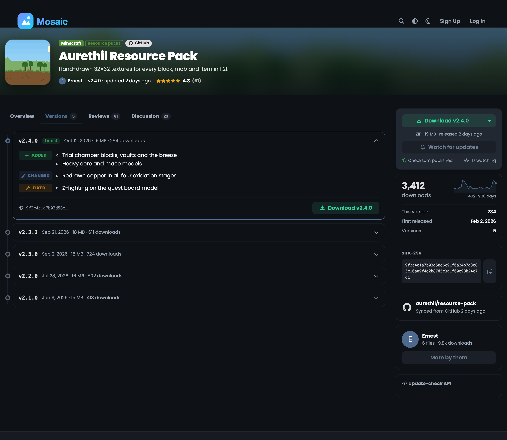 |
| A file's page | Every version, with its changelog |
| 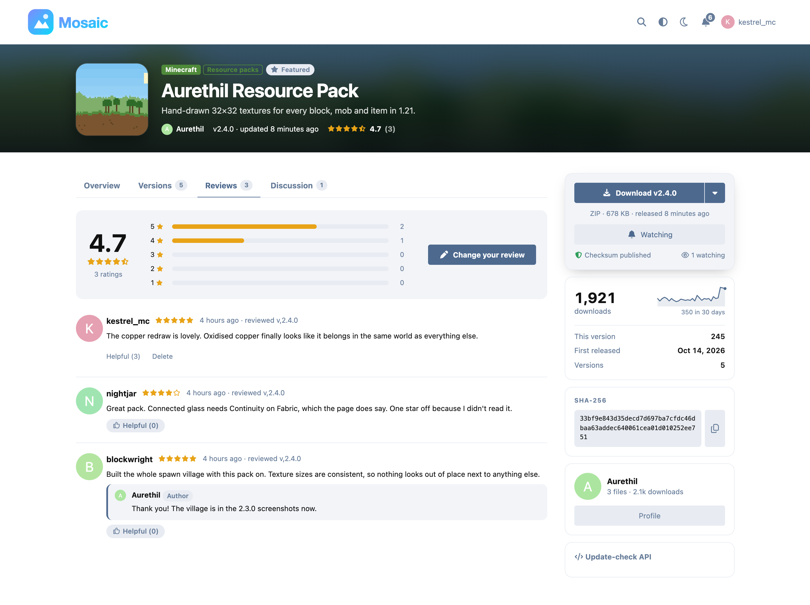 | 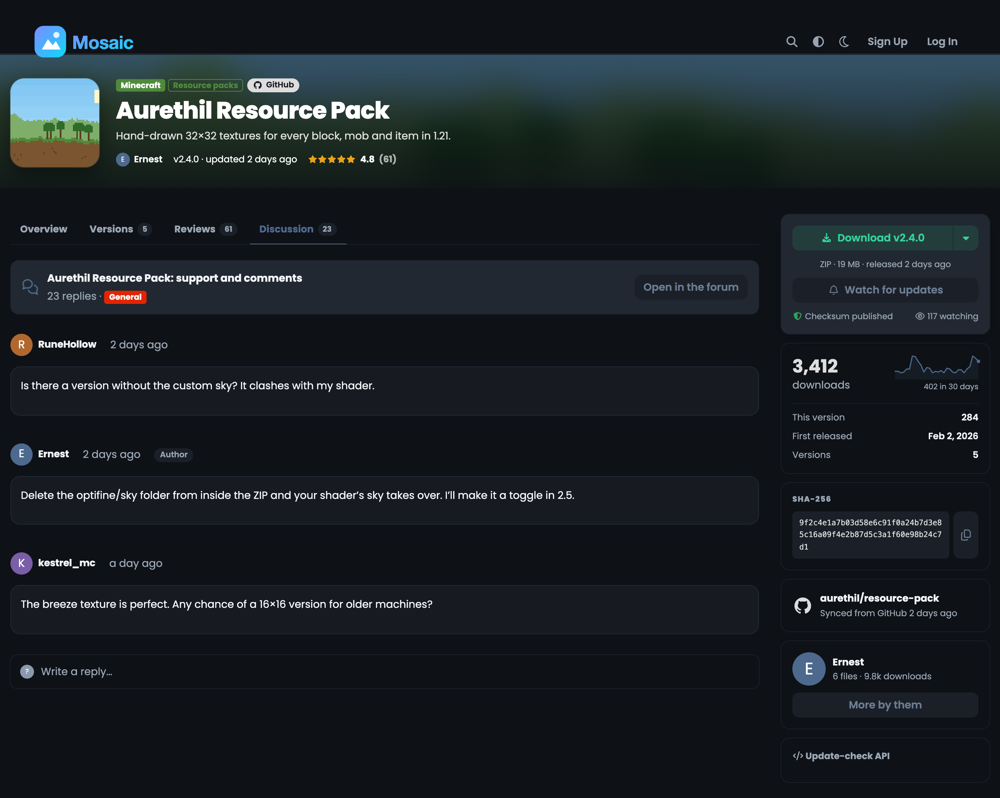 |
| Reviews | The support discussion |
| 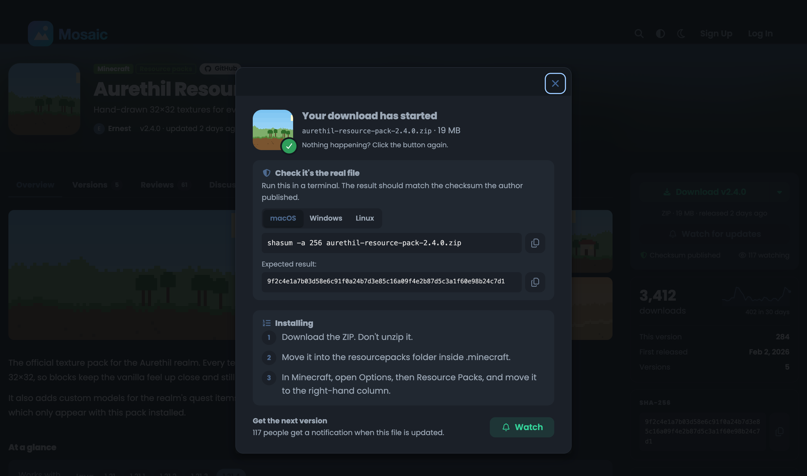 | 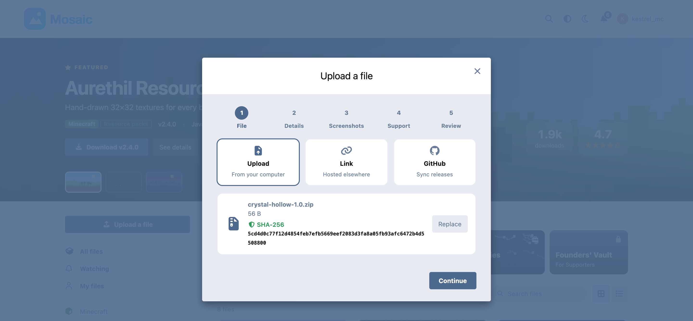 |
| After the download starts | Upload: the checksum is worked out on drop |
| 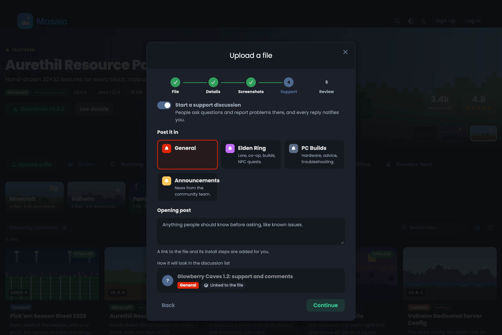 | 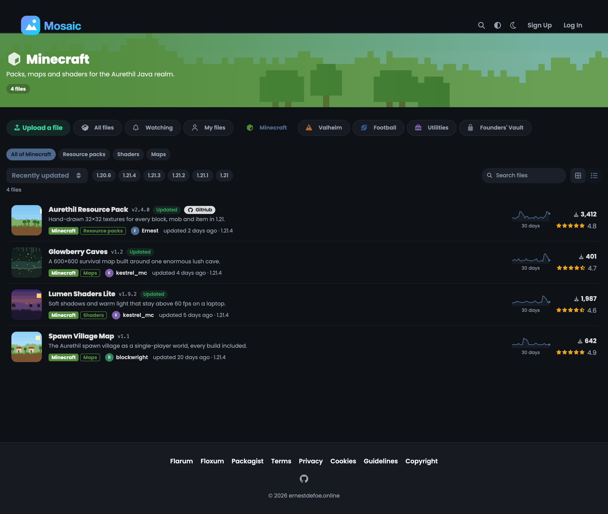 |
| Upload: pick the tag for the support discussion | A category, as a list |
| 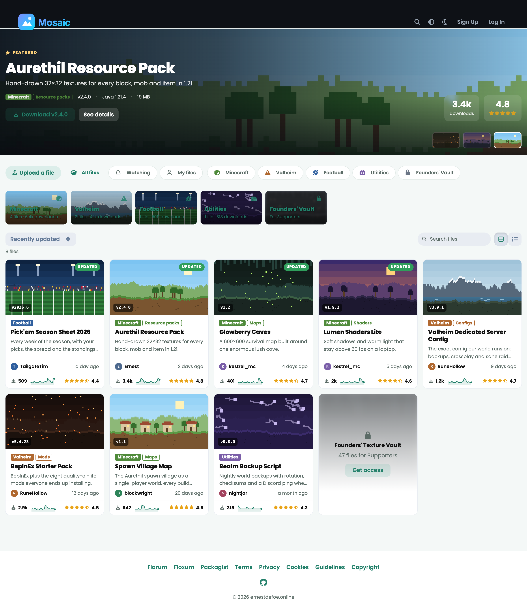 | 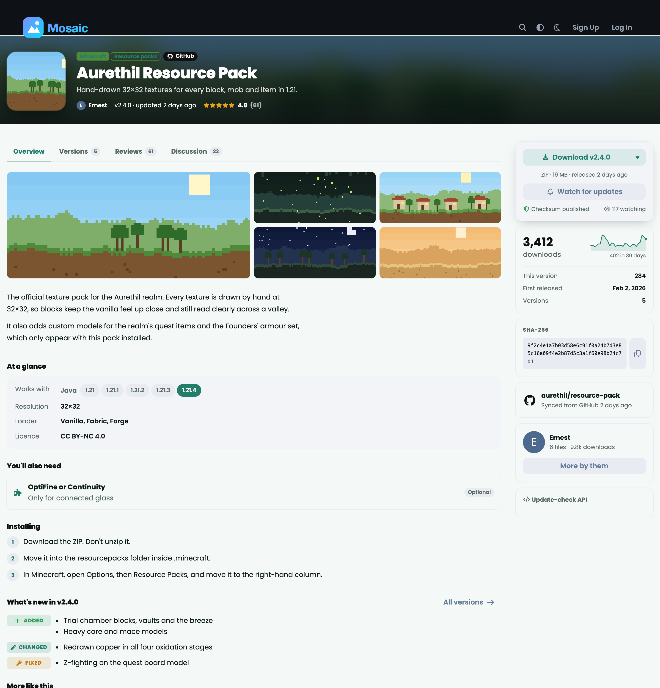 |
| Light scheme | Light scheme, file page |

<p>
  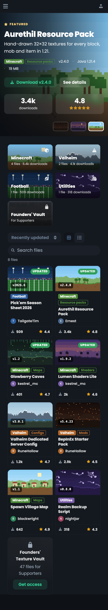
  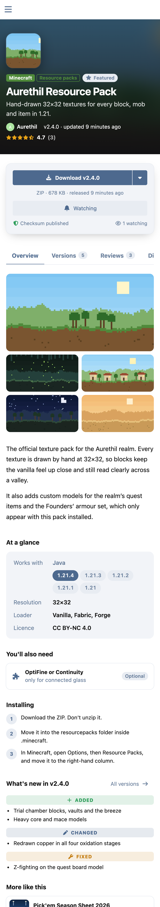
</p>

## Built on Flarum, not beside it

- The browse page is Flarum's `PageStructure` with a subclass of core's `IndexSidebar`, so the sidebar, the mobile drop-down and the page spacing are core's own, and any theme that styles the discussion list styles Depot too.
- Modals are Flarum's `Modal` and `FormModal`, the download button is core's `SplitDropdown`, and dates, avatars and alerts are core's.
- Every colour is a Flarum variable, so Depot follows the forum's theme and its light, dark and high-contrast schemes with no settings of its own.
- The pages load on demand. The bundle every forum page carries is 6 KB: the routes and one sidebar link.
- Every string is in `locale/en.yml`.

## Development

```bash
cd js && npm install && npm run build
```

Screenshots are taken with `node tools/shots.mjs` (headless Chrome, 2× density, reduced motion so nothing is caught mid-animation). Re-run it after any visual change.

## Licence

MIT. See [LICENSE](LICENSE).
